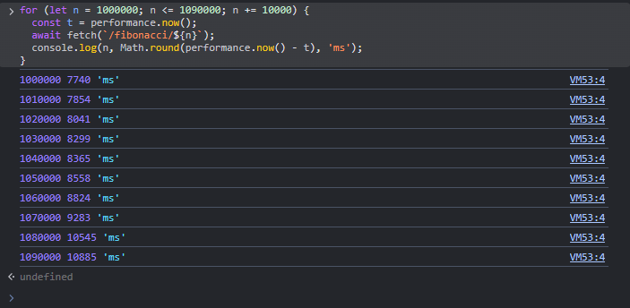
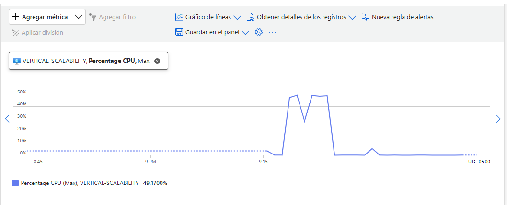
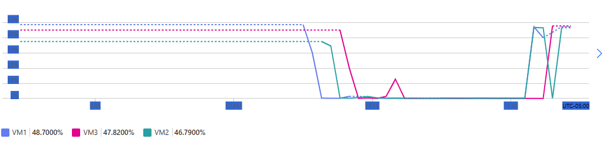
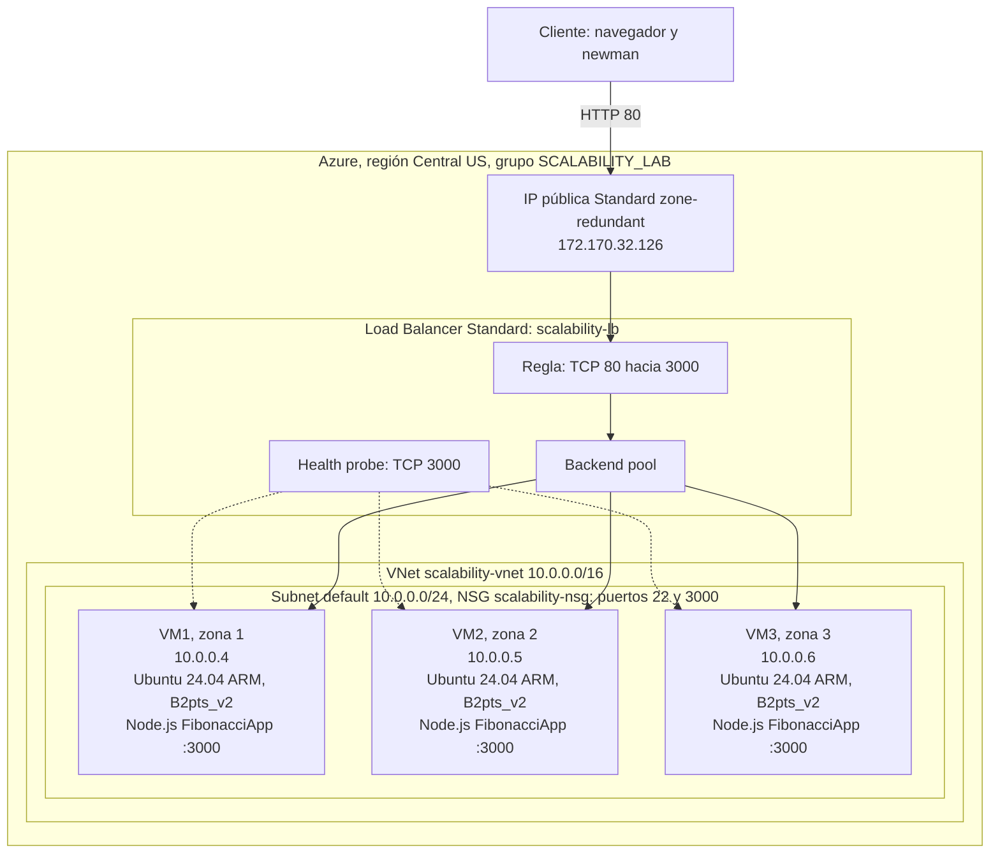

### Escuela Colombiana de Ingeniería
### Arquitecturas de Software - ARSW

## Autores:
- Samuel Castelblanco 
- Ángela Gómez 

## Escalamiento en Azure con Maquinas Virtuales, Sacale Sets y Service Plans

### Dependencias
* Cree una cuenta gratuita dentro de Azure. Para hacerlo puede guiarse de esta [documentación](https://azure.microsoft.com/es-es/free/students/). Al hacerlo usted contará con $100 USD para gastar durante 12 meses.

### Parte 0 - Entendiendo el escenario de calidad

Adjunto a este laboratorio usted podrá encontrar una aplicación totalmente desarrollada que tiene como objetivo calcular el enésimo valor de la secuencia de Fibonnaci.

**Escalabilidad**
Cuando un conjunto de usuarios consulta un enésimo número (superior a 1000000) de la secuencia de Fibonacci de forma concurrente y el sistema se encuentra bajo condiciones normales de operación, todas las peticiones deben ser respondidas y el consumo de CPU del sistema no puede superar el 70%.

### Parte 1 - Escalabilidad vertical

1. Diríjase a el [Portal de Azure](https://portal.azure.com/) y a continuación cree una maquina virtual con las características básicas descritas en la imágen 1 y que corresponden a las siguientes:
    * Resource Group = SCALABILITY_LAB
    * Virtual machine name = VERTICAL-SCALABILITY
    * Image = Ubuntu Server 
    * Size = Standard B1ls
    * Username = scalability_lab
    * SSH publi key = Su llave ssh publica


2. Para conectarse a la VM use el siguiente comando, donde las `x` las debe remplazar por la IP de su propia VM (Revise la sección "Connect" de la virtual machine creada para tener una guía más detallada).

    `ssh scalability_lab@xxx.xxx.xxx.xxx`

3. Instale node, para ello siga la sección *Installing Node.js and npm using NVM* que encontrará en este [enlace](https://linuxize.com/post/how-to-install-node-js-on-ubuntu-18.04/).
4. Para instalar la aplicación adjunta al Laboratorio, suba la carpeta `FibonacciApp` a un repositorio al cual tenga acceso y ejecute estos comandos dentro de la VM:

    `git clone <your_repo>`

    `cd <your_repo>/FibonacciApp`

    `npm install`

5. Para ejecutar la aplicación puede usar el comando `npm FibinacciApp.js`, sin embargo una vez pierda la conexión ssh la aplicación dejará de funcionar. Para evitar ese compartamiento usaremos *forever*. Ejecute los siguientes comando dentro de la VM.

    ` node FibonacciApp.js`

6. Antes de verificar si el endpoint funciona, en Azure vaya a la sección de *Networking* y cree una *Inbound port rule* tal como se muestra en la imágen. Para verificar que la aplicación funciona, use un browser y user el endpoint `http://xxx.xxx.xxx.xxx:3000/fibonacci/6`. La respuesta debe ser `The answer is 8`.


7. La función que calcula en enésimo número de la secuencia de Fibonacci está muy mal construido y consume bastante CPU para obtener la respuesta. Usando la consola del Browser documente los tiempos de respuesta para dicho endpoint usando los siguintes valores:
    * 1000000
    * 1010000
    * 1020000
    * 1030000
    * 1040000
    * 1050000
    * 1060000
    * 1070000
    * 1080000
    * 1090000    

8. Dírijase ahora a Azure y verifique el consumo de CPU para la VM. (Los resultados pueden tardar 5 minutos en aparecer).


9. Ahora usaremos Postman para simular una carga concurrente a nuestro sistema. Siga estos pasos.
    * Instale newman con el comando `npm install newman -g`. Para conocer más de Newman consulte el siguiente [enlace](https://learning.getpostman.com/docs/postman/collection-runs/command-line-integration-with-newman/).
    * Diríjase hasta la ruta `FibonacciApp/postman` en una maquina diferente a la VM.
    * Para el archivo `[ARSW_LOAD-BALANCING_AZURE].postman_environment.json` cambie el valor del parámetro `VM1` para que coincida con la IP de su VM.
    * Ejecute el siguiente comando.

    ```
    newman run ARSW_LOAD-BALANCING_AZURE.postman_collection.json -e [ARSW_LOAD-BALANCING_AZURE].postman_environment.json -n 10 &
    newman run ARSW_LOAD-BALANCING_AZURE.postman_collection.json -e [ARSW_LOAD-BALANCING_AZURE].postman_environment.json -n 10
    ```

10. La cantidad de CPU consumida es bastante grande y un conjunto considerable de peticiones concurrentes pueden hacer fallar nuestro servicio. Para solucionarlo usaremos una estrategia de Escalamiento Vertical. En Azure diríjase a la sección *size* y a continuación seleccione el tamaño `B2ms`.


11. Una vez el cambio se vea reflejado, repita el paso 7, 8 y 9.
12. Evalue el escenario de calidad asociado al requerimiento no funcional de escalabilidad y concluya si usando este modelo de escalabilidad logramos cumplirlo.
13. Vuelva a dejar la VM en el tamaño inicial para evitar cobros adicionales.

**Preguntas**

1. ¿Cuántos y cuáles recursos crea Azure junto con la VM?
2. ¿Brevemente describa para qué sirve cada recurso?
3. ¿Al cerrar la conexión ssh con la VM, por qué se cae la aplicación que ejecutamos con el comando `npm FibonacciApp.js`? ¿Por qué debemos crear un *Inbound port rule* antes de acceder al servicio?
4. Adjunte tabla de tiempos e interprete por qué la función tarda tando tiempo.
5. Adjunte imágen del consumo de CPU de la VM e interprete por qué la función consume esa cantidad de CPU.
6. Adjunte la imagen del resumen de la ejecución de Postman. Interprete:
    * Tiempos de ejecución de cada petición.
    * Si hubo fallos documentelos y explique.
7. ¿Cuál es la diferencia entre los tamaños `B2ms` y `B1ls` (no solo busque especificaciones de infraestructura)?
8. ¿Aumentar el tamaño de la VM es una buena solución en este escenario?, ¿Qué pasa con la FibonacciApp cuando cambiamos el tamaño de la VM?
9. ¿Qué pasa con la infraestructura cuando cambia el tamaño de la VM? ¿Qué efectos negativos implica?
10. ¿Hubo mejora en el consumo de CPU o en los tiempos de respuesta? Si/No ¿Por qué?
11. Aumente la cantidad de ejecuciones paralelas del comando de postman a `4`. ¿El comportamiento del sistema es porcentualmente mejor?

### Parte 2 - Escalabilidad horizontal

#### Crear el Balanceador de Carga

Antes de continuar puede eliminar el grupo de recursos anterior para evitar gastos adicionales y realizar la actividad en un grupo de recursos totalmente limpio.

1. El Balanceador de Carga es un recurso fundamental para habilitar la escalabilidad horizontal de nuestro sistema, por eso en este paso cree un balanceador de carga dentro de Azure tal cual como se muestra en la imágen adjunta.


2. A continuación cree un *Backend Pool*, guiese con la siguiente imágen.


3. A continuación cree un *Health Probe*, guiese con la siguiente imágen.


4. A continuación cree un *Load Balancing Rule*, guiese con la siguiente imágen.


5. Cree una *Virtual Network* dentro del grupo de recursos, guiese con la siguiente imágen.


#### Crear las maquinas virtuales (Nodos)

Ahora vamos a crear 3 VMs (VM1, VM2 y VM3) con direcciones IP públicas standar en 3 diferentes zonas de disponibilidad. Después las agregaremos al balanceador de carga.

1. En la configuración básica de la VM guíese por la siguiente imágen. Es importante que se fije en la "Avaiability Zone", donde la VM1 será 1, la VM2 será 2 y la VM3 será 3.


2. En la configuración de networking, verifique que se ha seleccionado la *Virtual Network*  y la *Subnet* creadas anteriormente. Adicionalmente asigne una IP pública y no olvide habilitar la redundancia de zona.


3. Para el Network Security Group seleccione "avanzado" y realice la siguiente configuración. No olvide crear un *Inbound Rule*, en el cual habilite el tráfico por el puerto 3000. Cuando cree la VM2 y la VM3, no necesita volver a crear el *Network Security Group*, sino que puede seleccionar el anteriormente creado.


4. Ahora asignaremos esta VM a nuestro balanceador de carga, para ello siga la configuración de la siguiente imágen.


5. Finalmente debemos instalar la aplicación de Fibonacci en la VM. para ello puede ejecutar el conjunto de los siguientes comandos, cambiando el nombre de la VM por el correcto

```
git clone https://github.com/daprieto1/ARSW_LOAD-BALANCING_AZURE.git

curl -o- https://raw.githubusercontent.com/creationix/nvm/v0.34.0/install.sh | bash
source /home/vm1/.bashrc
nvm install node

cd ARSW_LOAD-BALANCING_AZURE/FibonacciApp
npm install

npm install forever -g
forever start FibonacciApp.js
```

Realice este proceso para las 3 VMs, por ahora lo haremos a mano una por una, sin embargo es importante que usted sepa que existen herramientas para aumatizar este proceso, entre ellas encontramos Azure Resource Manager, OsDisk Images, Terraform con Vagrant y Paker, Puppet, Ansible entre otras.

#### Probar el resultado final de nuestra infraestructura

1. Porsupuesto el endpoint de acceso a nuestro sistema será la IP pública del balanceador de carga, primero verifiquemos que los servicios básicos están funcionando, consuma los siguientes recursos:

```
http://52.155.223.248/
http://52.155.223.248/fibonacci/1
```

2. Realice las pruebas de carga con `newman` que se realizaron en la parte 1 y haga un informe comparativo donde contraste: tiempos de respuesta, cantidad de peticiones respondidas con éxito, costos de las 2 infraestrucruras, es decir, la que desarrollamos con balanceo de carga horizontal y la que se hizo con una maquina virtual escalada.

3. Agregue una 4 maquina virtual y realice las pruebas de newman, pero esta vez no lance 2 peticiones en paralelo, sino que incrementelo a 4. Haga un informe donde presente el comportamiento de la CPU de las 4 VM y explique porque la tasa de éxito de las peticiones aumento con este estilo de escalabilidad.

```
newman run ARSW_LOAD-BALANCING_AZURE.postman_collection.json -e [ARSW_LOAD-BALANCING_AZURE].postman_environment.json -n 10 &
newman run ARSW_LOAD-BALANCING_AZURE.postman_collection.json -e [ARSW_LOAD-BALANCING_AZURE].postman_environment.json -n 10 &
newman run ARSW_LOAD-BALANCING_AZURE.postman_collection.json -e [ARSW_LOAD-BALANCING_AZURE].postman_environment.json -n 10 &
newman run ARSW_LOAD-BALANCING_AZURE.postman_collection.json -e [ARSW_LOAD-BALANCING_AZURE].postman_environment.json -n 10
```

**Preguntas**

* ¿Cuáles son los tipos de balanceadores de carga en Azure y en qué se diferencian?, ¿Qué es SKU, qué tipos hay y en qué se diferencian?, ¿Por qué el balanceador de carga necesita una IP pública?
* ¿Cuál es el propósito del *Backend Pool*?
* ¿Cuál es el propósito del *Health Probe*?
* ¿Cuál es el propósito de la *Load Balancing Rule*? ¿Qué tipos de sesión persistente existen, por qué esto es importante y cómo puede afectar la escalabilidad del sistema?.
* ¿Qué es una *Virtual Network*? ¿Qué es una *Subnet*? ¿Para qué sirven los *address space* y *address range*?
* ¿Qué son las *Availability Zone* y por qué seleccionamos 3 diferentes zonas?. ¿Qué significa que una IP sea *zone-redundant*?
* ¿Cuál es el propósito del *Network Security Group*?
* Informe de newman 1 (Punto 2)
* Presente el Diagrama de Despliegue de la solución.

---

## Respuestas

### Parte 1 - Escalabilidad vertical

**1. ¿Cuántos y cuáles recursos crea Azure junto con la VM?**

Azure crea 6 recursos junto con la VM:

* Máquina virtual
* Disco del sistema operativo
* Interfaz de red o NIC
* Dirección IP pública
* Network Security Group o NSG
* Red virtual o VNet con su subnet

**2. Describa brevemente para qué sirve cada recurso.**

* **Máquina virtual:** es el cómputo. Aporta la CPU y la memoria donde corre la aplicación.
* **Disco del sistema operativo:** guarda el sistema operativo, la aplicación instalada y los datos de forma persistente.
* **NIC:** conecta la VM a la red virtual y le asigna una IP privada.
* **IP pública:** permite llegar a la VM desde internet, por ejemplo por SSH o por el puerto 3000.
* **NSG:** es el firewall de la VM. Define qué tráfico entra y sale según el puerto, el protocolo y el origen.
* **VNet y subnet:** forman la red privada aislada donde vive la VM y desde donde se comunica con otros recursos de Azure.

**3. ¿Por qué se cae la aplicación al cerrar la conexión SSH? ¿Por qué hay que crear un Inbound port rule?**

Al ejecutar `node FibonacciApp.js` el proceso queda como hijo de la sesión SSH. Cuando la sesión se cierra, el sistema le envía la señal SIGHUP a todos sus procesos hijos y la aplicación termina. Herramientas como forever, pm2 o systemd desacoplan el proceso de la terminal y lo mantienen vivo.

El NSG bloquea por defecto todo el tráfico entrante que no esté permitido de forma explícita. Al crear la VM solo se abre el puerto 22 para SSH. Sin una regla que permita el puerto 3000, las peticiones HTTP nunca llegan a la aplicación.

**4. Tabla de tiempos e interpretación.**

Mediciones tomadas desde la consola del navegador sobre la VM Standard_B2pts_v2. Se usó este tamaño porque la cuenta Azure for Students tiene bloqueados B1ls y B2ms en todas las regiones permitidas.

| n | Tiempo en ms |
|---|---|
| 1000000 | 7740 |
| 1010000 | 7854 |
| 1020000 | 8041 |
| 1030000 | 8299 |
| 1040000 | 8365 |
| 1050000 | 8558 |
| 1060000 | 8824 |
| 1070000 | 9283 |
| 1080000 | 10545 |
| 1090000 | 10885 |



La función hace n - 1 sumas con números de precisión arbitraria. El enésimo número de Fibonacci tiene cerca de 0,2 x n dígitos, así que cada suma es más costosa a medida que avanza el ciclo. El costo total crece más rápido que lineal: al pasar de 1000000 a 1090000, n aumenta un 9% pero el tiempo aumenta un 40%. Además, cada respuesta envía unos 209 KB de texto.

**5. Imagen del consumo de CPU e interpretación.**



El consumo máximo se mantiene cerca del 49% durante las pruebas. La VM tiene 2 vCPU, pero Node.js ejecuta el código de la aplicación en un solo hilo. El cálculo ocupa el 100% de un núcleo y deja el otro casi libre, por eso la CPU total nunca pasa del 50%. Esto muestra que agregar vCPU a la misma máquina no acelera esta aplicación.

**6. Resumen de la ejecución de Postman: tiempos de cada petición y fallos.**

Se ejecutaron 2 procesos de newman en paralelo, cada uno con 10 peticiones de n = 1000000.

| Proceso | Peticiones | Fallidas | Tiempo promedio | Mínimo | Máximo | Duración total |
|---|---|---|---|---|---|---|
| newman 1 | 10 | 5 | 11,3 s | 8,2 s | 15,8 s | 1 m 28 s |
| newman 2 | 10 | 4 | 10 s | 8 s | 15,9 s | 1 m 28 s |

* **Tiempos:** una petición sola tarda unos 8 s. Con dos clientes concurrentes, una petición puede llegar mientras el servidor calcula la del otro cliente y debe esperar a que termine. Por eso aparecen tiempos de hasta 16 s, el doble de una petición aislada.
* **Fallos:** 9 de 20 peticiones fallaron con `read ECONNRESET`, es decir, el servidor cerró la conexión. La aplicación no se reinició ni se quedó sin memoria. La causa es que el cálculo bloquea el event loop de Node.js durante unos 8 s. En ese tiempo el servidor no puede atender las conexiones abiertas: cuando el event loop se libera, cierra las conexiones keep-alive que superaron su tiempo de espera, y los clientes que ya habían enviado una petición por ellas reciben un reset. Los fallos aparecen en iteraciones alternas de cada proceso, lo que coincide con este patrón. El sistema no cumple el escenario de calidad, porque no todas las peticiones se responden.

**7. ¿Cuál es la diferencia entre los tamaños B2ms y B1ls?**

* **B1ls:** 1 vCPU y 0,5 GiB de RAM. Es el tamaño más pequeño y barato de Azure, pensado para cargas mínimas.
* **B2ms:** 2 vCPU y 8 GiB de RAM, con un rendimiento base de CPU más alto y más créditos acumulables.

Ambos son de la serie B, que es *burstable*. Mientras la CPU está por debajo de su línea base, la VM acumula créditos, y los gasta cuando necesita superarla. Si los créditos se agotan, la CPU queda limitada a la línea base. Por eso la serie B sirve para cargas intermitentes y no para cómputo intensivo sostenido como el de este laboratorio.

B2ms también cuesta varias veces más que B1ls por hora.

**8. ¿Aumentar el tamaño de la VM es una buena solución en este escenario? ¿Qué pasa con la FibonacciApp al cambiar el tamaño?**

No es una buena solución. Node.js ejecuta el código de la aplicación en un solo hilo, así que el cálculo de Fibonacci usa un solo núcleo aunque la VM tenga dos. Más vCPU no mejora el tiempo de una petición y apenas ayuda con la concurrencia. Además, el escalamiento vertical tiene un techo físico y su costo crece rápido.

Al cambiar el tamaño, Azure reinicia la VM. La aplicación se detiene y, si no está configurada para arrancar con el sistema, queda abajo hasta que alguien la vuelva a iniciar.

**9. ¿Qué pasa con la infraestructura al cambiar el tamaño de la VM? ¿Qué efectos negativos implica?**

Azure apaga la VM, la reasigna a un hardware que soporte el nuevo tamaño y la vuelve a encender. Los efectos negativos son:

* Hay tiempo de inactividad: el servicio no está disponible durante el cambio.
* Se pierden las conexiones activas y los procesos en memoria.
* La IP pública puede cambiar si es dinámica.
* El nuevo tamaño puede no estar disponible en el clúster o en la región.
* Sigue habiendo un único punto de falla.

**10. ¿Hubo mejora en el consumo de CPU o en los tiempos de respuesta? ¿Por qué?**

No hubo una mejora significativa. La VM se escaló de Standard_B2pts_v2, con 2 vCPU y 1 GiB, a Standard_B4ps_v2, con 4 vCPU y 16 GiB. Se usaron estos tamaños porque B1ls y B2ms no están disponibles en la cuenta de estudiante.

| n | B2pts_v2 en ms | B4ps_v2 en ms |
|---|---|---|
| 1000000 | 7740 | 7616 |
| 1010000 | 7854 | 7680 |
| 1020000 | 8041 | 7903 |
| 1030000 | 8299 | 8037 |
| 1040000 | 8365 | 8277 |
| 1050000 | 8558 | 8387 |
| 1060000 | 8824 | 8462 |
| 1070000 | 9283 | 8602 |
| 1080000 | 10545 | 8849 |
| 1090000 | 10885 | 8895 |

* **Tiempos:** para n pequeños la diferencia es menor al 2%. Para los n más grandes mejora hasta un 18%, probablemente porque la máquina grande tiene más memoria para manejar números de cientos de miles de dígitos y más créditos de CPU. Aun así, cada petición sigue tardando cerca de 8 s.
* **CPU:** el máximo pasó del 49% al 25%. No es que el cálculo consuma menos: Node.js sigue usando un solo núcleo, que ahora representa 1 de 4 vCPU en lugar de 1 de 2. Las otras 3 vCPU quedan ociosas.
* **Newman con 2 procesos:** fallaron 9 de 20 peticiones, igual que con la VM pequeña. El tiempo promedio bajó de 10,7 s a 9,9 s.

Pagar más del doble por la máquina no resuelve el problema, porque el cuello de botella es el hilo único de Node.js y no la cantidad de vCPU.

**11. Con 4 ejecuciones paralelas de Postman, ¿el comportamiento del sistema es porcentualmente mejor?**

No. Resultados en la VM Standard_B4ps_v2:

| Ejecuciones paralelas | Peticiones | Fallidas | Tasa de fallo | Tiempo promedio |
|---|---|---|---|---|
| 2 | 20 | 9 | 45% | 9,9 s |
| 4 | 40 | 19 | 47,5% | 22,4 s |

La tasa de fallo se mantiene cerca de la mitad de las peticiones, y el tiempo promedio de respuesta se duplica. Con más clientes concurrentes, cada petición espera a que se resuelvan las que llegaron antes en el único hilo de Node.js. Las 4 vCPU no ayudan, porque el proceso no puede repartir el trabajo entre ellas. El sistema empeora a medida que crece la carga, que es lo opuesto a lo que pide el escenario de escalabilidad.

### Parte 2 - Escalabilidad horizontal

**¿Cuáles son los tipos de balanceadores de carga en Azure y en qué se diferencian? ¿Qué es SKU, qué tipos hay y en qué se diferencian? ¿Por qué el balanceador necesita una IP pública?**

Tipos de balanceadores:

* **Azure Load Balancer:** trabaja en capa 4 con TCP y UDP dentro de una región. Puede ser público o interno.
* **Application Gateway:** trabaja en capa 7 con HTTP y HTTPS dentro de una región. Enruta por URL o por host, termina SSL y puede incluir WAF.
* **Front Door:** es un balanceador global de capa 7 sobre la red perimetral de Microsoft, con caché y aceleración.
* **Traffic Manager:** es un balanceador global basado en DNS. Dirige a los clientes hacia el endpoint más adecuado.

SKU es el nivel de producto del recurso y define sus capacidades, límites, SLA y precio. El Load Balancer tiene tres SKU:

* **Basic:** gratuito, sin SLA, sin soporte de zonas de disponibilidad, hasta 300 instancias y abierto por defecto. Azure lo retiró en septiembre de 2025.
* **Standard:** con costo y SLA del 99,99%, admite zonas de disponibilidad y hasta 1000 instancias. Es seguro por defecto: bloquea el tráfico que un NSG no permita.
* **Gateway:** sirve para insertar dispositivos virtuales de red de terceros, como firewalls, en la ruta del tráfico.

El balanceador necesita una IP pública porque es el punto de entrada único para los clientes en internet. Recibe todas las peticiones en esa IP y las distribuye a las VMs del backend, que pueden quedar sin exposición directa. Un balanceador interno usaría una IP privada.

**¿Cuál es el propósito del Backend Pool?**

Es el grupo de VMs o instancias que reciben el tráfico del balanceador. Para escalar horizontalmente solo hay que agregar o quitar máquinas del pool.

**¿Cuál es el propósito del Health Probe?**

Revisa periódicamente el estado de cada instancia del backend, por ejemplo consultando el puerto 3000 o una ruta HTTP. Si una instancia no responde, el balanceador deja de enviarle tráfico hasta que se recupere.

**¿Cuál es el propósito de la Load Balancing Rule? ¿Qué tipos de sesión persistente existen, por qué es importante y cómo afecta la escalabilidad?**

La regla define cómo se distribuye el tráfico: une el frontend IP y su puerto con el backend pool y su puerto, usando un health probe y un protocolo determinados. En este laboratorio, el puerto 80 del balanceador se envía al puerto 3000 de las VMs.

Tipos de sesión persistente:

* **None:** usa un hash de 5 tuplas: IP origen, puerto origen, IP destino, puerto destino y protocolo. Cada conexión nueva puede ir a una VM distinta.
* **Client IP:** usa un hash de 2 tuplas, IP origen e IP destino. Un mismo cliente siempre va a la misma VM.
* **Client IP and protocol:** usa un hash de 3 tuplas, IP origen, IP destino y protocolo.

La persistencia importa cuando la aplicación guarda estado de sesión en memoria, porque el cliente debe volver al servidor que tiene ese estado. El costo es que la carga puede quedar desbalanceada: muchos usuarios detrás de una misma IP, como una red corporativa o un NAT, terminan en la misma VM, y al agregar nodos el tráfico existente no se redistribuye. Para escalar mejor, la aplicación debe ser stateless y la sesión debe guardarse en un almacenamiento externo.

**¿Qué es una Virtual Network? ¿Qué es una Subnet? ¿Para qué sirven el address space y el address range?**

* **Virtual Network:** es una red privada y aislada en Azure donde los recursos se comunican entre sí, con internet y con redes locales.
* **Subnet:** es una subdivisión de la VNet que permite segmentar los recursos y aplicarles reglas y NSG por separado.
* **Address space:** es el bloque de IPs privadas, en notación CIDR, que le pertenece a toda la VNet. Por ejemplo, 10.0.0.0/16.
* **Address range:** es la porción de ese espacio que se asigna a cada subnet. Por ejemplo, 10.0.0.0/24. Los rangos de las subnets no pueden solaparse.

**¿Qué son las Availability Zones y por qué seleccionamos 3 zonas diferentes? ¿Qué significa que una IP sea zone-redundant?**

Las Availability Zones son ubicaciones físicamente separadas dentro de una misma región de Azure. Cada una tiene su propia energía, refrigeración y red.

Usamos 3 zonas distintas para que una falla en un datacenter no tumbe todo el sistema. Si una zona cae, las VMs de las otras dos siguen atendiendo y el balanceador redirige el tráfico.

Una IP zone-redundant existe en todas las zonas de la región al mismo tiempo, así que sigue funcionando aunque una zona completa falle.

**¿Cuál es el propósito del Network Security Group?**

Filtra el tráfico de red que entra y sale de las NIC o subnets mediante reglas de permitir o denegar por IP, puerto, protocolo y dirección. Funciona como el firewall de las VMs. En este laboratorio permite SSH por el puerto 22 y la aplicación por el puerto 3000.

**Informe de newman 1, punto 2.**

La infraestructura horizontal se desplegó en Central US con un Load Balancer Standard y 3 VMs Standard_B2pts_v2, una en cada zona de disponibilidad. La aplicación se instaló automáticamente con [cloud-init](cloud-init.yaml) y quedó como servicio de systemd.

Resultados de newman, con 10 peticiones de n = 1000000 por proceso:

| Infraestructura | Procesos paralelos | Peticiones | Fallidas | Tasa de éxito | Tiempo promedio |
|---|---|---|---|---|---|
| Vertical, 1 VM B2pts_v2 | 2 | 20 | 9 | 55% | 10,7 s |
| Vertical, 1 VM B4ps_v2 | 2 | 20 | 9 | 55% | 9,9 s |
| Vertical, 1 VM B4ps_v2 | 4 | 40 | 19 | 52,5% | 22,4 s |
| Horizontal, 3 VMs B2pts_v2 | 2 | 20 | 0 | 100% | 8,2 s |
| Horizontal, 3 VMs B2pts_v2 | 4 | 40 | 8 | 80% | 9,1 s |

Costos por hora en Central US con precios públicos de Azure. No incluyen los discos, que son iguales en ambos casos:

| Infraestructura | Componentes | Costo por hora | Costo por mes |
|---|---|---|---|
| Vertical, VM pequeña | 1 VM B2pts_v2 a $0,0095 + 1 IP pública a $0,005 | $0,015 | $11 |
| Vertical, VM escalada | 1 VM B4ps_v2 a $0,152 + 1 IP pública a $0,005 | $0,157 | $115 |
| Horizontal | 3 VMs B2pts_v2 a $0,0285 + 3 IPs públicas a $0,015 + Load Balancer Standard a $0,025 aproximado | $0,069 | $50 |

**Conclusiones:**

* **Tiempos:** con balanceo, cada petición tarda lo mismo que una petición aislada, unos 8 s, porque cada VM atiende su propia petición sin esperar a las demás. En la VM escalada, con 4 procesos el promedio subía a 22,4 s porque todas las peticiones hacían fila en el mismo hilo.
* **Éxito:** con 2 procesos no falló ninguna petición. Con 4 procesos, la tasa de éxito pasó de 52,5% a 80%. Los fallos restantes aparecen porque hay más clientes que VMs: dos peticiones caen en la misma máquina y se repite el bloqueo del event loop.
* **Costo:** la infraestructura horizontal cuesta menos de la mitad que la VM escalada y responde mucho mejor. Además tolera la caída de una zona completa y permite agregar o quitar nodos sin reiniciar el servicio.

**CPU de las VMs, punto 3:**



Las tres VMs alcanzan entre 46,8% y 48,7% de CPU al mismo tiempo. Cada una usa al máximo el único núcleo que ocupa Node.js, y el balanceador reparte la carga entre las tres. La tasa de éxito aumenta porque se multiplican los hilos de ejecución disponibles: tres procesos de Node.js independientes en lugar de uno.

No fue posible agregar la cuarta VM. La cuenta Azure for Students tiene un límite de 6 vCPU y de 3 IPs públicas por región, y las 3 VMs de 2 vCPU ya ocupan las 6 vCPU. Por el límite de IPs, VM3 se creó sin IP pública: recibe el tráfico por su IP privada a través del balanceador.

**Diagrama de despliegue de la solución.**



## Videos

* **Parte 1, escalabilidad vertical:** [Ver video](videos/parte1-escalabilidad-vertical.mp4)
* **Parte 2, escalabilidad horizontal:** [Ver video](videos/parte2-escalabilidad-horizontal.mp4)
